# Караваев Иван ИТ-4 Лабораторная №1

# Задание 1. Методы

## Задача 1. Дробная часть

### Текст задачи

Дана сигнатура функции: `double fraction(double x);`

Необходимо реализовать функцию таким образом, чтобы она возвращала только дробную часть числа x.


Пример:

x = 5,25

Результат: 0,25

### Алгоритм решения

1. Функция принимает вещественное число x.
2. Создается целочисленная переменная, в которую записывается целая часть числа x путем преобразования типа double в int.
3. Из исходного числа x вычитается полученная целая часть.
4. Полученная разность является дробной частью числа.
5. Функция возвращает результат вычисления.

### Тестирование
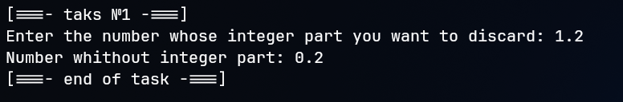


## Задача 3. Букву в число

### Текст задачи

Дана сигнатура функции: `int charToNum(char x);`

Функция принимает символ x, который представляет собой один из символов «0 1 2 3 4 5 6 7 8 9». Необходимо реализовать функцию таким образом, чтобы она преобразовывала символ в соответствующее число.

Пример:

x = '3'

Результат: 3

### Алгоритм решения

1. Функция принимает один символ x.
2. Так как символы цифр в таблице ASCII расположены последовательно, можно получить числовое значение символа путем вычитания кода символа '0' из кода принятого символа.
3. Полученная разность соответствует числу, которое обозначает переданный символ.
4. Функция возвращает полученное целое число.

### Тестирование
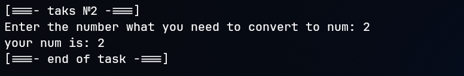


## Задача 5. Двузначное

### Текст задачи

Дана сигнатура функции: `bool is2Digits(int x);`

Необходимо реализовать функцию таким образом, чтобы она принимала число x и возвращала true, если оно двузначное.

Пример 1:

x = 32

Результат: true

Пример 2:

x = 516

Результат: false

### Алгоритм решения

1. Функция принимает целое число x.
2. Проверяется, находится ли число в диапазоне от 10 до 99 или от -99 до -10.
3. Для проверки можно использовать два условия: число должно быть не меньше 10 и не больше 99 по модулю.
4. Если хотя бы один из допустимых диапазонов подходит, функция возвращает true.
5. В противном случае функция возвращает false.

### Тестирование
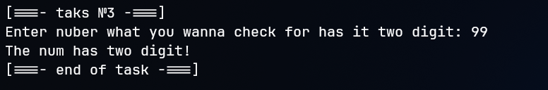


## Задача 7. Диапазон

### Текст задачи

Дана сигнатура функции: `bool isInRange(int a, int b, int num);`

Функция принимает левую и правую границу (a и b) некоторого числового диапазона. Необходимо реализовать функцию таким образом, чтобы она возвращала true, если num входит в указанный диапазон (включая границы).

Обратите внимание, что отношение a и b заранее неизвестно (неясно, кто из них больше, а кто меньше).

Пример 1:

a = 5, b = 1, num = 3

Результат: true

Пример 2:

a = 2, b = 15, num = 33

Результат: false

### Алгоритм решения

1. Функция принимает три целых числа: a, b и num.
2. Сначала определяется минимальная граница диапазона. Для этого сравниваются значения a и b.
3. Затем определяется максимальная граница диапазона.
4. Проверяется, находится ли число num между минимальной и максимальной границами включительно.
5. Если число удовлетворяет обоим условиям, функция возвращает true.
6. Если число выходит за пределы диапазона, функция возвращает false.

### Тестирование
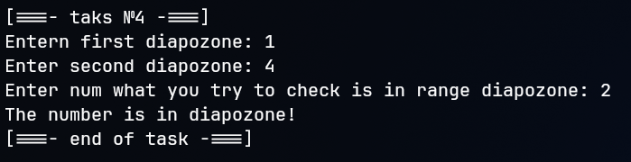


## Задача 9. Равенство

### Текст задачи

Дана сигнатура функции: `bool isEqual(int a, int b, int c);`

Необходимо реализовать функцию таким образом, чтобы она возвращала true, если все три полученных функцией числа равны.

Пример 1:

a = 3, b = 3, c = 3

Результат: true

Пример 2:

a = 2, b = 15, c = 2

Результат: false

### Алгоритм решения

1. Функция принимает три целых числа: a, b и c.
2. Выполняется сравнение первого числа со вторым.
3. Выполняется сравнение второго числа с третьим.
4. Если оба сравнения истинны, значит, все три числа равны.
5. В этом случае функция возвращает true.
6. Если хотя бы одно сравнение ложно, функция возвращает false.

### Тестирование
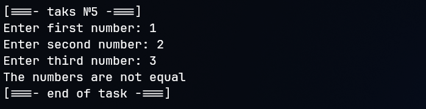


# Задание 2. Условия

## Задача 1. Модуль числа

### Текст задачи

Дана сигнатура функции: `int abs(int x);`

Необходимо реализовать функцию таким образом, чтобы она возвращала модуль числа x (если оно было положительным, то таким и остается, если оно было отрицательным — то необходимо вернуть его без знака минус).

Пример 1:

x = 5

Результат: 5

Пример 2:

x = -3

Результат: 3

### Алгоритм решения

1. Функция принимает целое число x.
2. Проверяется знак переданного числа.
3. Если число положительное или равно нулю, оно остается без изменений.
4. Если число отрицательное, необходимо изменить его знак на противоположный.
5. Полученное значение возвращается из функции.

### Тестирование
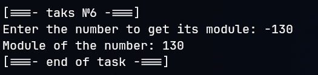


## Задача 3. Тридцать пять

### Текст задачи

Дана сигнатура функции: `bool is35(int x);`

Необходимо реализовать функцию таким образом, чтобы она возвращала true, если число x делится нацело на 3 или 5. При этом, если оно делится и на 3, и на 5, то вернуть надо false.

Пример 1:

x = 5

Результат: true

Пример 2:

x = 8

Результат: false

Пример 3:

x = 15

Результат: false

### Алгоритм решения

1. Функция принимает целое число x.
2. Проверяется, делится ли число x на 3 без остатка.
3. Отдельно проверяется, делится ли число x на 5 без остатка.
4. Если число делится только на 3 или только на 5, функция возвращает true.
5. Если число одновременно делится на 3 и на 5, функция возвращает false.
6. Если число не делится ни на 3, ни на 5, функция также возвращает false.

### Тестирование
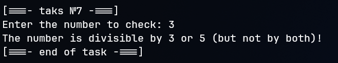


## Задача 5. Тройной максимум

### Текст задачи

Дана сигнатура функции: `int max3(int x, int y, int z);`

Необходимо реализовать функцию таким образом, чтобы она возвращала максимальное из трех полученных функцией чисел.

Пример 1:

x = 5, y = 7, z = 7

Результат: 7

Пример 2:

x = 8, y = -1, z = 4

Результат: 8

### Алгоритм решения

1. Функция принимает три целых числа: x, y и z.
2. В качестве начального максимального значения выбирается первое число x.
3. Первое условие проверяет, больше ли число y текущего максимального значения. Если да, максимальное значение заменяется на y.
4. Второе условие проверяет, больше ли число z текущего максимального значения. Если да, максимальное значение заменяется на z.
5. После выполнения двух проверок в переменной остается наибольшее из трех чисел.
6. Функция возвращает найденное максимальное значение.

### Тестирование
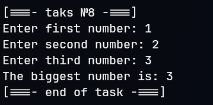


## Задача 7. Двойная сумма

### Текст задачи

Дана сигнатура функции: `int sum2(int x, int y);`

Необходимо реализовать функцию таким образом, чтобы она возвращала сумму чисел x и y. Однако, если сумма попадает в диапазон от 10 до 19, то надо вернуть число 20.

Пример 1:

x = 5, y = 7

Результат: 20

Пример 2:

x = 8, y = -1

Результат: 7

### Алгоритм решения

1. Функция принимает два целых числа x и y.
2. Вычисляется сумма двух переданных чисел.
3. Проверяется, находится ли полученная сумма в диапазоне от 10 до 19 включительно.
4. Если сумма входит в указанный диапазон, функция возвращает число 20.
5. Если сумма не входит в данный диапазон, функция возвращает первоначальную сумму чисел x и y.

### Тестирование
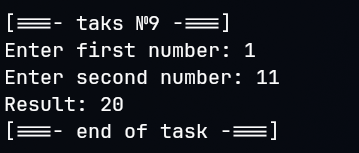


## Задача 9. День недели

### Текст задачи

Дана сигнатура функции: `String day(int x);`

Функция принимает число x, обозначающее день недели. Необходимо реализовать функцию таким образом, чтобы она возвращала строку, которая будет обозначать текущий день недели, где 1 — это понедельник, а 7 — воскресенье.

Если число не от 1 до 7, то верните текст «это не день недели».

Вместо if в данной задаче используйте switch.

Пример:

x = 5

Результат: «пятница»

### Алгоритм решения

1. Функция принимает целое число x, обозначающее номер дня недели.
2. Для выбора названия дня недели используется оператор switch.
3. Для значения 1 возвращается строка «понедельник».
4. Для значения 2 возвращается строка «вторник».
5. Для значения 3 возвращается строка «среда».
6. Для значения 4 возвращается строка «четверг».
7. Для значения 5 возвращается строка «пятница».
8. Для значения 6 возвращается строка «суббота».
9. Для значения 7 возвращается строка «воскресенье».
10. Если переданное число не соответствует ни одному из перечисленных значений, срабатывает ветка default, которая возвращает строку «это не день недели».

### Тестирование
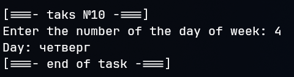


# Задание 3. Циклы

## Задача 1. Числа подряд

### Текст задачи

Дана сигнатура функции: `String listNums(int x);`

Необходимо реализовать функцию таким образом, чтобы она возвращала строку, в которой будут записаны все числа от 0 до x (включительно).

Пример:

x = 5

Результат: «0 1 2 3 4 5»

### Алгоритм решения

1. Функция принимает целое число x.
2. Создается пустая строка, в которую будут записываться числа.
3. Организуется цикл, начинающийся с числа 0 и заканчивающийся числом x включительно.
4. На каждой итерации текущее значение счетчика преобразуется в строку и добавляется к общей строке.
5. Между числами добавляются пробелы для разделения значений.
6. После завершения цикла сформированная строка возвращается из функции.

### Тестирование
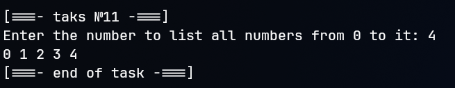


## Задача 3. Четные числа

### Текст задачи

Дана сигнатура функции: `String chet(int x);`

Необходимо реализовать функцию таким образом, чтобы она возвращала строку, в которой будут записаны все четные числа от 0 до x (включительно).

Пример:

x = 9

Результат: «0 2 4 6 8»

### Алгоритм решения

1. Функция принимает целое число x.
2. Создается пустая строка для хранения четных чисел.
3. Организуется цикл, начинающийся с нуля и продолжающийся до значения x включительно.
4. Для получения только четных чисел счетчик цикла увеличивается на 2 после каждой итерации.
5. Текущее значение счетчика преобразуется в строку и добавляется к общей строке.
6. Между числами добавляются пробелы.
7. После завершения цикла функция возвращает сформированную строку.
8. Инструкция if не используется, поскольку шаг цикла сразу обеспечивает перебор только четных чисел.

### Тестирование
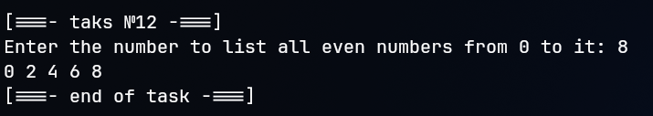


## Задача 5. Длина числа

### Текст задачи

Дана сигнатура функции: `int numLen(long x);`

Необходимо реализовать функцию таким образом, чтобы она возвращала количество знаков в числе x.

Пример:

x = 12567

Результат: 5

### Алгоритм решения

1. Функция принимает целое число x типа long.
2. Создается переменная-счетчик, первоначальное значение которой равно нулю.
3. Если число равно нулю, количество его знаков равно одному.
4. Если число отрицательное, для дальнейших вычислений рассматривается его положительное значение.
5. Организуется цикл, в котором число последовательно делится на 10.
6. После каждого деления счетчик увеличивается на единицу.
7. Цикл продолжается до тех пор, пока число не станет равным нулю.
8. После завершения цикла счетчик содержит количество цифр числа.
9. Функция возвращает значение счетчика.

### Тестирование
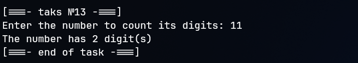


## Задача 7. Квадрат

### Текст задачи

Дана сигнатура функции: `void square(int x);`

Необходимо реализовать функцию таким образом, чтобы она выводила на экран квадрат из символов '*' размером x, у которого x символов в ряд и x символов в высоту.

Пример 1:

x = 2

Результат:
```
**
**
```
Пример 2:

x = 4

Результат:
```
****
****
****
****
```
### Алгоритм решения

1. Функция принимает целое число x, определяющее размер квадрата.
2. Создается внешний цикл, который отвечает за количество строк.
3. Внешний цикл выполняется x раз.
4. Внутри внешнего цикла создается внутренний цикл, отвечающий за количество символов в каждой строке.
5. Внутренний цикл также выполняется x раз.
6. На каждой итерации внутреннего цикла выводится символ '*'.
7. После завершения внутреннего цикла выполняется переход на новую строку.
8. В результате на экране отображается квадрат размером x на x символов.

### Тестирование
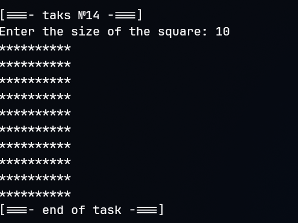


## Задача 9. Правый треугольник

### Текст задачи

Дана сигнатура функции: `void rightTriangle(int x);`

Необходимо реализовать функцию таким образом, чтобы она выводила на экран треугольник из символов '*' у которого x символов в высоту, а количество символов в ряду совпадает с номером строки, при этом треугольник выровнен по правому краю.


x = 3

Результат:
```
  *
 **
***
```
Пример 2:

x = 4

Результат:
```
   *
  **
 ***
****
```
### Алгоритм решения

1. Функция принимает целое число x, определяющее высоту треугольника.
2. Создается внешний цикл, который перебирает строки от 1 до x.
3. Для каждой строки определяется количество пробелов, которое необходимо вывести перед символами '*'.
4. Количество пробелов вычисляется как разность между общей высотой треугольника и номером текущей строки.
5. С помощью первого внутреннего цикла выводятся необходимые пробелы.
6. С помощью второго внутреннего цикла выводятся символы '*'. Их количество соответствует номеру текущей строки.
7. После вывода пробелов и звездочек выполняется переход на новую строку.
8. После завершения внешнего цикла на экране отображается треугольник, выровненный по правому краю.

### Тестирование
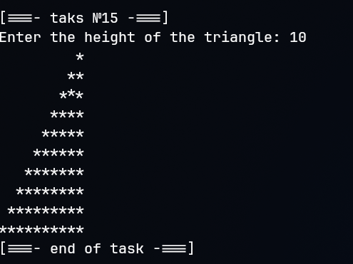


# Задание 4. Массивы

## Задача 1. Поиск первого значения

### Текст задачи

Дана сигнатура функции: `int findFirst(int arr[], int x);`

Необходимо реализовать функцию таким образом, чтобы она возвращала индекс первого вхождения числа x в массив arr. Если число не входит в массив — возвращается -1.

Пример:

arr = [1, 2, 3, 4, 2, 2, 5]

x = 2

Результат: 1

### Алгоритм решения

1. Функция принимает массив arr и число x, которое необходимо найти.
2. Создается цикл для последовательного перебора элементов массива, начиная с первого элемента.
3. На каждой итерации текущий элемент массива сравнивается с числом x.
4. Если найден элемент, равный x, функция сразу возвращает его индекс.
5. Поскольку перебор начинается с начала массива, найденный индекс будет соответствовать первому вхождению числа.
6. Если цикл завершился и совпадений не найдено, функция возвращает -1.

### Тестирование
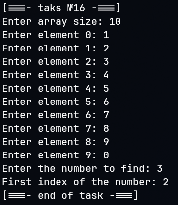


## Задача 3. Поиск максимального

### Текст задачи

Дана сигнатура функции: `int maxAbs(int arr[]);`

Необходимо реализовать функцию таким образом, чтобы она возвращала наибольшее по модулю (то есть без учета знака) значение массива arr.

Пример:

arr = [1, -2, -7, 4, 2, 2, 5]

Результат: -7

### Алгоритм решения

1. Функция принимает массив целых чисел arr.
2. В качестве начального максимального элемента выбирается первый элемент массива.
3. Создается цикл для последовательного перебора остальных элементов массива.
4. На каждой итерации вычисляется модуль текущего элемента и модуля элемента, который на данный момент считается максимальным.
5. Полученные значения сравниваются между собой.
6. Если модуль текущего элемента больше модуля сохраненного максимального элемента, текущий элемент становится новым максимальным.
7. После завершения цикла переменная содержит элемент с наибольшим абсолютным значением.
8. Функция возвращает исходное значение этого элемента, сохраняя его знак.

### Тестирование
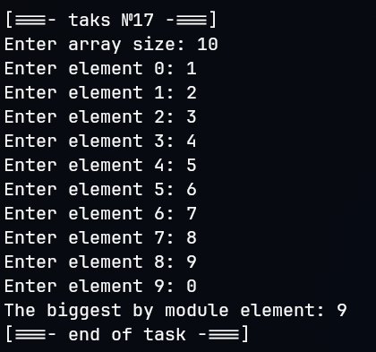


## Задача 5. Добавление массива в массив

### Текст задачи

Дана сигнатура функции: `int* add(int arr[], int ins[], int pos);`

Необходимо реализовать функцию таким образом, чтобы она возвращала новый массив, который будет содержать все элементы массива arr, однако в позицию pos будут вставлены значения массива ins.

Пример:

arr = [1, 2, 3, 4, 5]

ins = [7, 8, 9]

pos = 3

Результат: [1, 2, 3, 7, 8, 9, 4, 5]

### Алгоритм решения

1. Функция принимает два массива: arr и ins, а также позицию pos, в которую необходимо вставить второй массив.
2. Определяется количество элементов в исходном массиве arr и вставляемом массиве ins.
3. Вычисляется размер нового массива путем сложения размеров двух исходных массивов.
4. Создается новый массив необходимого размера.
5. В новый массив копируются элементы исходного массива arr, расположенные до позиции pos.
6. Далее в новый массив последовательно копируются все элементы массива ins.
7. После этого копируются оставшиеся элементы массива arr, начиная с позиции pos.
8. В результате получается новый массив, содержащий все элементы исходного массива и вставленные элементы второго массива.
9. Функция возвращает указатель на новый массив.

### Тестирование
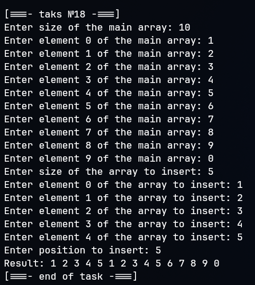


## Задача 7. Возвратный реверс

### Текст задачи

Дана сигнатура функции: `int* reverseBack(int arr[]);`

Необходимо реализовать функцию таким образом, чтобы она возвращала новый массив, в котором значения массива arr записаны задом наперед.

Пример:

arr = [1, 2, 3, 4, 5]

Результат: [5, 4, 3, 2, 1]

### Алгоритм решения

1. Функция принимает исходный массив arr.
2. Определяется количество элементов исходного массива.
3. Создается новый массив такого же размера, как исходный.
4. Организуется цикл для последовательного перебора элементов исходного массива.
5. Каждый элемент исходного массива записывается в новый массив в обратном порядке.
6. Для этого элемент с индексом i исходного массива помещается в позицию, соответствующую обратному индексу нового массива.
7. После завершения цикла новый массив содержит все элементы исходного массива в обратной последовательности.
8. Функция возвращает указатель на новый массив.

### Тестирование
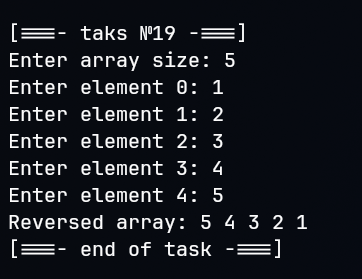


## Задача 9. Все вхождения

### Текст задачи

Дана сигнатура функции: `int* findAll(int arr[], int x);`

Необходимо реализовать функцию таким образом, чтобы она возвращала новый массив, в котором записаны индексы всех вхождений числа x в массив arr.

Пример:

arr = [1, 2, 3, 8, 2, 2, 9]

x = 2

Результат: [1, 4, 5]

### Алгоритм решения

1. Функция принимает исходный массив arr и число x, вхождения которого необходимо найти.
2. Создается счетчик, первоначальное значение которого равно нулю.
3. Организуется первый цикл для перебора всех элементов исходного массива.
4. Каждый элемент массива сравнивается с числом x.
5. Если элемент равен x, счетчик увеличивается на единицу.
6. После завершения первого цикла становится известно количество вхождений искомого числа.
7. Создается новый массив, размер которого равен полученному количеству вхождений.
8. Организуется второй цикл для повторного перебора элементов исходного массива.
9. Если текущий элемент равен x, его индекс записывается в новый массив.
10. После завершения второго цикла новый массив содержит индексы всех вхождений числа x.
11. Функция возвращает указатель на новый массив.

### Тестирование
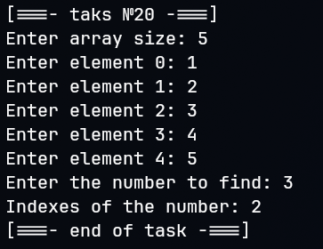
